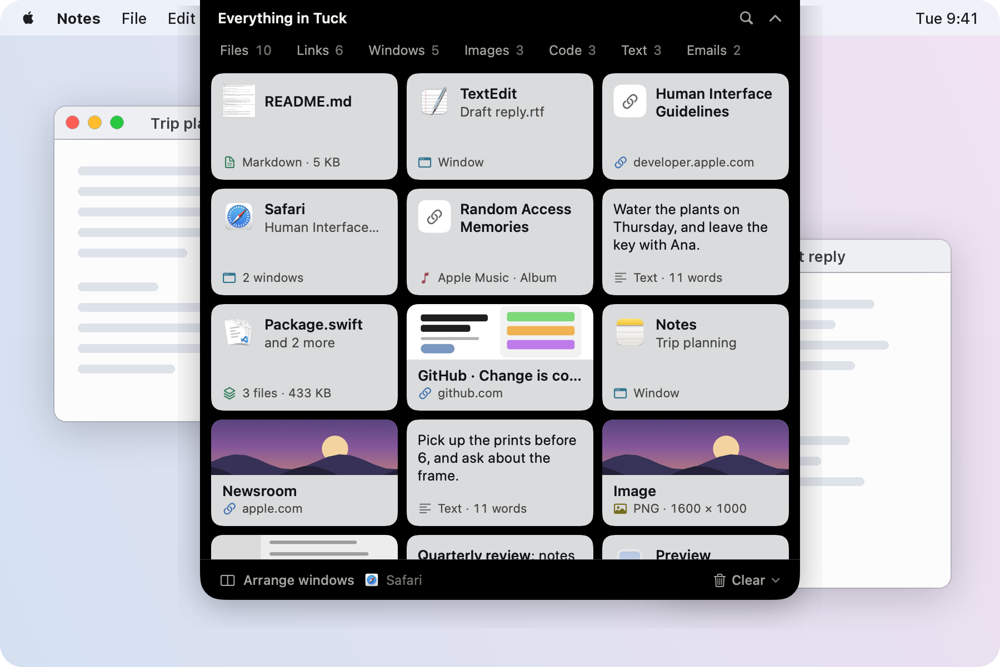

<p align="center">
  <picture>
    <source media="(prefers-color-scheme: dark)" srcset="design/logo/svg/tuck-logo-horizontal-reversed.svg">
    
  </picture>
</p>

<h3 align="center">Clear the desk. Keep your place.</h3>

<p align="center">Windows, files, links and notes, kept in your Mac's notch until you want them.</p>

<p align="center">
  macOS 14 or later · Apple silicon · Free<br>
  <a href="#install">Install</a> · <a href="docs/guide.md">Guide</a> · <a href="#line-apps">Line Apps</a>
</p>

<p align="center">
  
</p>

## What it does

- **Tuck a window.** The window in front goes into the notch at once, with no trip to the Dock, and
  one click brings it back exactly where it was.
- **Hold anything.** Drop files, links, music, text or images on the notch. Tuck keeps them, follows
  files that move, and lets you drag them out again.
- **One stream.** Everything Tuck holds is in one stream, newest first, each thing shown as what it is:
  a colour as its swatch, a link with its page's title, code with numbered lines. Opened fully, it has a
  search that reads kinds and days, such as "images today" or "links".
- **Add only what you want.** Clipboard history, keyboard shortcuts, moving and resizing windows with
  a modifier key, and smooth mouse-wheel scrolling all stay off until you turn them on.

<p align="center">
  
</p>

On a display without a notch, Tuck sits in the menu bar as a small bubble.

## Install

```sh
brew install --cask millerroberts180/line-apps/tuck
```

Use the full name: Homebrew's own catalogue has a different app called `tuck`. Or download Tuck from
[its page](https://lineapps.vercel.app/tuck/) and drag it to Applications, or get all four apps at once
with the [Line Apps installer](https://lineapps.vercel.app).

Tuck isn't notarized yet, so macOS stops it the first time it opens. Choose **Done**, then open System
Settings › Privacy & Security and choose **Open Anyway** beside Tuck. On macOS 14 you can also
Control-click Tuck in Applications and choose **Open**. Setup then asks for Accessibility, for tucking
windows, and has you try Tuck on the notch itself.

## Private and light

- **Online only to preview what you copy.** No analytics and no account. While clipboard history (off
  by default) is on, Tuck fetches a copied link's title, icon and sharing picture and an address's map;
  nothing else connects.
- **Light at rest:** under 0.1% CPU, about 12 MB of memory, and an app under 4 MB. The fold is built
  when it opens and released when it closes, and pictures load only while it is open.
- **Native:** Swift, SwiftUI and AppKit, with no third-party dependencies.

## Requirements

- macOS 14 or later, on Apple silicon. Tested so far on macOS 15.7; see
  [Newer macOS](docs/guide.md#newer-macos).
- The Accessibility permission, to tuck windows, and access to the files you drop.

## Build from source

```sh
scripts/signing-identity.sh   # once per Mac, so the Accessibility grant survives rebuilds
scripts/build-app.sh          # builds build/Tuck.app
open build/Tuck.app
scripts/test.sh               # runs the tests
```

Debug flags and off-screen snapshots are in [docs/development.md](docs/development.md).

## Documentation

- **[Guide](docs/guide.md):** every gesture and setting, and how each feature behaves
- **[Development](docs/development.md):** building, debug flags, snapshots and tests
- **[Architecture](docs/architecture.md):** modules, runtime structure and extension points
- **[Decision log](docs/decision-log.md):** what was decided, why, and how it was checked
- **[Releasing](docs/release.md):** signing, notarizing and the launch checklist
- **[Logo](design/logo/README.md):** the mark, its colours and its files
- **[Legal](docs/legal):** the EULA and privacy policy, drafts for legal review

## Line Apps

Tuck is one of four small Mac apps with one maker and one quiet design, each doing one job:

| App | What it does |
| --- | --- |
| **[Tuck](https://github.com/millerroberts180/tuck)** | Windows, files, links and notes, kept in your Mac's notch |
| **[Pulse](https://github.com/millerroberts180/pulse)** | Feel web pages through your trackpad, and give typing a nicer sound |
| **[Hum](https://github.com/millerroberts180/hum)** | The song you're playing, as album art in a small floating player |
| **[Glow](https://github.com/millerroberts180/glow)** | Brightness, volume and each monitor's own settings, for every display |

[Line Apps](https://github.com/millerroberts180/line-apps) itself is a short line in the menu bar that
their icons collapse into, and one installer for all four. The
[Homebrew tap](https://github.com/millerroberts180/homebrew-line-apps) has each app's cask.

## Licence

Tuck is free to use, with every feature for everyone. © 2026 Miller Roberts. All rights reserved.
