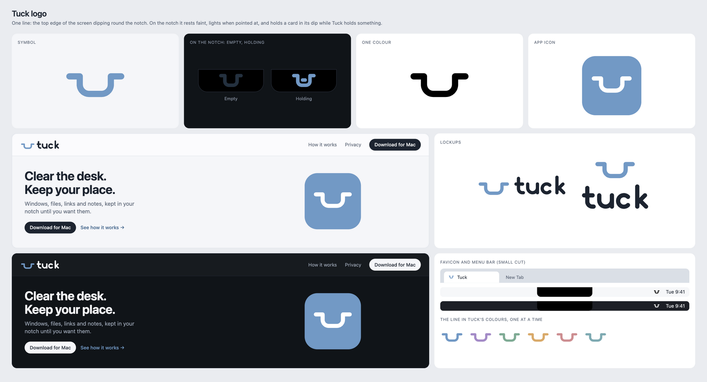

# Tuck logo

One rounded line: the top edge of the screen, dipping down round the notch, where Tuck keeps what you
put away. It is the app's own shape, the notch and the rim that wraps it when something is dropped in.
The line is a single colour, Tuck Blue in the app. It is Pulse's sibling:
the same 256 grid, the same 24-unit line, round ends.



## Files

| Folder | What's in it |
| --- | --- |
| `svg/` | Masters. `tuck-symbol` and `tuck-symbol-small` in Tuck Blue, `-black` and `-white`, plus the symbol in each of Tuck's other colours (`-purple`, `-green`, `-orange`, `-rose`, `-teal`). `tuck-notch-holding` shows the notch's holding state (the small cut with its card) for docs; it is not a logo. `tuck-logo-horizontal`, `tuck-logo-stacked` and `tuck-wordmark` in colour, `-reversed` (for dark backgrounds), `-black` and `-white` |
| `png/` | Large PNGs for documents, press and social posts |
| `web/` | Favicon (`favicon.svg`, `favicon.ico`), touch and PWA icons, `site.webmanifest`, `head.html` to paste into a page, and `tokens.css` with the site's colours and type |
| `source/` | 1024 masters for the app icon (regular and small cut) and the web icons |
| `exploration/` | The concept rounds this came from: rounds 1 and 2 for the old drawer mark, round 3 for the line and its colours, round 4 for the ways of showing that a space holds something |
| `board.html`, `board.png` | The logo in use: website header, the notch, app icon, favicon, menu bar, the other colours |

The symbol has no reversed version: the line is one colour, so Tuck Blue (or another of Tuck's colours) works on
light and dark backgrounds alike. Only the lockups have `-reversed`, which turns the wordmark Paper.

The app icon is built into `Support/AppIcon.icns` and copied into the bundle by `scripts/build-app.sh`.
In the app, `Sources/TuckApp/App/TuckLogo.swift` draws the line in code: the mark on the closed notch,
the menu-bar icon (the small cut, as a template image), the logo on the About pane in Settings and the
mark at the top of setup's first page. There is no image resource to load.

To change the logo, edit the geometry in `generate.py`, then run both steps from the repository root:

```sh
python3 design/logo/generate.py     # every SVG
swift design/logo/render.swift      # PNGs, Support/AppIcon.icns, favicon.ico and web icons
```

If the line's geometry changes, update the numbers in `TuckLogo.swift` to match.

## Colours

Tuck Blue is the app's own (`TuckLogo.blue` in `Sources/TuckApp/App/TuckLogo.swift`), so the logo, the
app and the website read as one product. The five other colours were once the colours of Tuck's
spaces; they stay for illustrations and the website, one at a time.

| Name | HEX | RGB | Use |
| --- | --- | --- | --- |
| Tuck Blue | `#7299C5` | 114 153 197 | The line; the app icon's tile; accents |
| Ink | `#1D2430` | 29 36 48 | The wordmark, text, primary buttons |
| Tuck Blue ink | `#42658B` | 66 101 139 | Blue as text or links on light backgrounds |
| Paper | `#F4F6F9` | 244 246 249 | Light background; the wordmark on dark backgrounds |
| Night | `#111418` | 17 20 24 | Dark background |
| White | `#FFFFFF` | 255 255 255 | The app icon's line, as on Pulse's and Hum's icons |
| Purple, Green, Orange, Rose, Teal | `#A48BC7` `#7FAB94` `#D9AA69` `#CD8E91` `#7DAAB2` | | Illustrations and the website: the line takes one of them |

Print values (CMYK, Pantone) haven't been matched yet; proof them before printing anything.

On light backgrounds use the colour logo; on dark backgrounds use the `-reversed` lockups. When only one
colour is possible, use `-black` or `-white`.

## At rest, pointed at, empty and holding

On the closed notch the line is faint at rest and lights when you point at it, and its card says whether
Tuck holds anything:

- **At rest:** the line at 32 % of its colour.
- **Pointed at:** the line at full colour, fading on in 0.16 s as its dip greets the pointer, and back
  to 32 % as the pointer leaves.
- **Holding:** a short card at full colour resting in the dip, at rest or pointed at: as wide as the
  line, 16 units clear of the floor, 12 to 14 clear of the walls (`tuck-notch-holding` shows it with the
  line lit).
- **Starting to hold:** a window tucked at rest flies up as a dot just above the dip. The card drops
  into the dip from above on a spring and settles, with a quick swell of the mark. A deposit into a
  Tuck that already holds something lands on the card and swells the mark.
- **Emptying:** the card lifts out in 0.2 s.
- **Reduce Motion:** the card cross-fades, and the greeting is skipped.

The card belongs to the notch, not the logo. Elsewhere (the app icon, the website, documents) use the
line alone.

## Type

The wordmark is drawn, not set in a font, so it needs no font licence. Around it, on the website and in
documents, use the system font (SF Pro through `-apple-system`), as the app does.

## Sizes and spacing

- **Clear space:** keep at least the depth of the dip (about a third of the line's width) free on every
  side.
- **Small cut:** below 32 px, use `tuck-symbol-small`. It is bolder, with shorter tails and a deeper dip,
  so the dip stays open at 16 px, with or without its card. The favicon, the menu-bar icon, the mark on the notch and the 16 and
  32 px app icons already use it.
- **Minimum sizes:** symbol 16 px; horizontal logo 72 px wide; stacked logo 48 px wide.

## App icon

The line in white on a Tuck Blue tile, as Pulse's and Hum's icons are built. A blue tile stands out in a
dark Dock, menu or Finder window. The touch and PWA icons use the same colours. The
About pane draws its own copy (`TuckMark` in `Sources/TuckApp/Settings/SettingsComponents.swift`); if the
icon's colours change in `app_icon()` in `generate.py`, change them there too.

## Don't

- Fill the dip in, or put anything in it but the notch's card. Leave the card out of the logo itself.
- Use more than one colour in the line, or show the line in several colours at once.
- Round the shoulders into curls, or change the tails' length, the dip's depth or the line's weight
  outside the two cuts.
- Animate the mark on a loop. It lights once as the pointer arrives and dims once as it leaves; its card
  drops in once when Tuck starts holding something and lifts out once when it empties.
- Add shadows, gradients, outlines or glass to the mark itself. The app icon's tile is the only container.
- Put the Ink wordmark on dark or busy backgrounds, or stretch, rotate or rearrange the lockups.
- Set "tuck" in a font in place of the drawn wordmark.

Trademark clearance hasn't been checked; do that before registering or shipping the mark widely.
